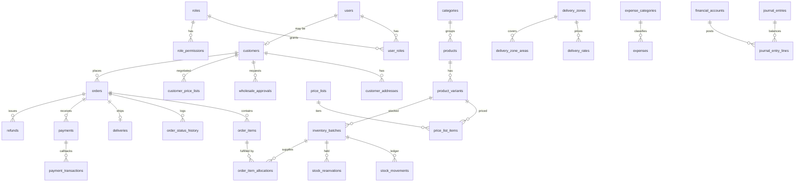

# Nem Battambang — Architecture & Design

Retail + wholesale e-commerce and back-office for a Cambodian nem business.
This document is the Step 1 design. The [Implementation checklist](#9-implementation-checklist)
at the end tracks what is built and what is not.

---

## 1. System architecture

**Modular monolith**: one Next.js app (storefront, admin, and API) and one PostgreSQL database.

```
Browser ──HTTPS──> Nginx (rate-limit /api/auth, security headers)
                     │
                     ▼
              Next.js 16 (standalone, Node 24)
              ├─ src/proxy.ts           coarse route gate (/admin, /account)
              ├─ app/(store)/*          storefront (RSC + small client islands)
              ├─ app/admin/*            back office
              ├─ server actions         all mutations (validated with Zod, permission-checked)
              └─ features/*/domain      pure business rules (pricing, delivery, FEFO, P&L)
                     │ Prisma 7 + pg driver adapter
                     ▼
              PostgreSQL 17 (private network only, never published)
              S3-compatible storage (product photos, receipts, delivery proofs)
```

Rules that hold everywhere:

1. **Money is `Decimal(14,2)`** in the DB and `decimal.js` in code. JS floats never touch money.
2. **The client never sends a price.** It sends `(variantId, quantity)`. Prices, discounts, delivery
   fees and totals are recomputed on the server (`features/cart/quote.ts`).
3. **Permissions are read from the database on every request** (`features/auth/guard.ts`), not trusted
   from the JWT, so revoking a role takes effect at once.
4. **Business rules are pure functions** in `features/*/domain/*.ts` with unit tests. Server actions
   load data, call the rule, and write inside a `db.$transaction`.
5. **Snapshots preserve history**: order lines copy SKU, names, list price, selling price and price
   source; orders copy the delivery address; COGS copies batch unit cost at shipment.

## 2. Business modules

| Module | Owns | Key rule file |
|---|---|---|
| Auth & RBAC | users, roles, permissions, audit log | `features/auth/permissions.ts` |
| Catalog | categories, products, variants, images | `features/catalog/queries.ts` |
| Pricing | retail, wholesale tiers, customer lists, promotions, price history | `features/pricing/domain/pricing.ts` |
| Customers | customers, addresses, wholesale approvals, groups | — (Phase 2) |
| Cart & Checkout | cart quote, idempotent checkout | `features/cart/quote.ts` |
| Orders | orders, items, status history, returns | `features/orders/domain/order-rules.ts` |
| Inventory | locations, batches, movements, reservations, write-offs | `features/inventory/domain/fefo.ts` |
| Delivery | locations, zones, rates, providers, drivers, deliveries | `features/delivery/domain/delivery-fee.ts` |
| Payments | payments, gateway transactions, refunds | `features/orders/domain/order-rules.ts` |
| Finance | expense categories, expenses, accounts, journal | `features/finance/domain/pnl.ts` |
| Reports | dashboard, P&L, sales/inventory reports | `features/reports/*` |
| Settings | system settings, currencies, exchange rates, sequences | `features/settings/queries.ts` |

## 3. User roles

Defined in `features/auth/permissions.ts` and seeded into `roles` / `permissions`.

| Permission | Super Admin | Admin | Sales Mgr | Sales Staff | Inventory Mgr | Delivery | Accountant |
|---|:-:|:-:|:-:|:-:|:-:|:-:|:-:|
| product.view / edit | ✓/✓ | ✓/✓ | ✓/– | ✓/– | ✓/✓ | – | ✓/– |
| price.edit | ✓ | ✓ | ✓ | – | – | – | – |
| cost.view | ✓ | ✓ | – | – | ✓ | – | ✓ |
| customer.view / edit | ✓ | ✓ | ✓ | ✓ | – | – | – |
| wholesale.approve | ✓ | ✓ | ✓ | – | – | – | – |
| order.view / manage | ✓ | ✓ | ✓ | ✓ | view | – | view |
| payment.confirm | ✓ | ✓ | ✓ | – | – | – | ✓ |
| inventory.adjust | ✓ | ✓ | – | – | ✓ | – | – |
| delivery.update / fees | ✓ | ✓ | – | – | – | update | – |
| expense.record / approve | ✓ | ✓ | – | – | – | – | ✓ |
| report.profit | ✓ | ✓ | – | – | – | – | ✓ |
| user.manage | ✓ | ✓ | – | – | – | – | – |
| settings.manage | ✓ | – | – | – | – | – | – |

Retail and Wholesale Customers have no back-office permissions. Wholesale eligibility comes from
`customers.wholesaleStatus = APPROVED`, not from a role.

## 4. Database ERD (core)

Full schema: [`prisma/schema.prisma`](../prisma/schema.prisma) (≈50 tables).



Design notes:

- UUID keys for business records; integer keys for the Cambodian gazetteer (province → district → commune → village).
- `inventory_batches.onHandQty` / `reservedQty` are the source of truth for availability;
  `stock_movements` is the append-only ledger explaining every change.
- `payment_transactions (provider, externalId)` is **unique**, which makes gateway callbacks idempotent.
- `orders.idempotencyKey` is **unique**, which makes checkout submission idempotent.
- `sequences` provides gap-tolerant, race-free document numbers (`NB-2611-00042`) via `INSERT … ON CONFLICT … RETURNING`.
- `expense_categories.class` (`OPERATING` / `DELIVERY` / `INVENTORY`) stops double counting:
  inventory-class spend is capitalised into batch cost and reaches the P&L only through COGS.

## 5. Key business rules

### Pricing (server only)
1. Customer-specific negotiated tier (customer linked to the list, list valid today)
2. Public wholesale tier (customer is an **approved** wholesale customer)
3. Retail price
4. Best valid promotion is then applied to a retail or wholesale base. **Negotiated prices are not stacked with promotions.**

Tiers are validated as non-overlapping with no unbounded tier in the middle (`validateTiers`).

### Delivery fee
`fee = baseFee + weight surcharge` (WEIGHT) or `baseFee + quantity surcharge` (QUANTITY).
Surcharges are per **started** step beyond the included amount. Both apply only on an explicit
`COMBINED` rate. A free threshold on the goods subtotal zeroes the fee; a max weight blocks the rate.
Manual override is stored next to the calculated fee, with a required reason.

### Inventory
- **FEFO**: allocate from the earliest-expiring sellable batch.
- A batch is sellable only if it has at least `max(1, inventory.minRemainingShelfDays)` days left. Expired stock and stock expiring today cannot ship.
- Order confirmation creates `stock_reservations` and increments `reservedQty` inside a transaction with `SELECT … FOR UPDATE` on the batches, which prevents overselling under concurrency.
- Cancellation releases reservations. Shipment converts reservations into `SALE_OUT` movements and writes `order_item_allocations` with the batch `unitCost` (immutable COGS snapshot).
- Valuation: **specific batch cost (FIFO-equivalent via FEFO)**.

### Order lifecycle
`DRAFT → PENDING → CONFIRMED → PREPARING → SHIPPED → COMPLETED`, with `CANCELLED` allowed before
shipment and `RETURNED` after. Payment status is separate and **derived** from verified payments and
refunds, never set by hand. Uploaded KHQR screenshots are evidence only; a payment is counted when
a user with `payment.confirm` verifies it.

### P&L (management report, not statutory)
- Revenue is recognised at `COMPLETED`, at snapshot prices.
- `Net Profit = Revenue − COGS − Delivery expenses − Operating expenses − Write-offs − Other losses`.
- Margins are `null` when revenue is 0.
- A double-entry journal (`journal_entries` / `journal_entry_lines`, debits = credits, posted entries locked)
  is in the schema for a formal ledger in Phase 5.

## 6. Folder structure

```
prisma/                  schema, migrations, seed (DEMO data)
src/
  app/
    (store)/             storefront routes: /, /products, /products/[slug], /cart, /login, /[page]
    admin/               back office: /admin, /admin/[module]
    api/auth, api/health
  auth.ts, auth.config.ts, proxy.ts
  components/ui          shadcn/ui primitives
  components/{brand,store,admin,common}
  features/<module>/
    domain/*.ts          pure rules + *.test.ts
    queries.ts           server-only reads
    actions.ts           "use server" mutations (Zod + requirePermission + transaction)
  i18n/                  km/en dictionaries, cookie locale
  lib/                   db, money, rate-limit, utils
  generated/prisma       Prisma client (gitignored, `prisma generate`)
docker/nginx/            reverse-proxy config
```

## 7. Server action / API design

All mutations are server actions; route handlers exist only for Auth.js, health, and (later) payment
gateway webhooks. Every action follows the same shape:

```ts
export async function confirmOrder(input: unknown) {
  const user = await requirePermission("order.manage");      // 1. authz from DB
  const data = confirmOrderSchema.parse(input);                // 2. Zod validation
  return db.$transaction(async (tx) => {                       // 3. atomic
    /* lock rows, call domain rule, write, write status history + audit log */
  });
}
```

| Area | Actions (planned names) |
|---|---|
| Catalog | `saveProduct`, `saveVariant`, `archiveProduct`, `uploadProductImage` |
| Pricing | `savePriceList` (runs `validateTiers`), `assignCustomerPriceList`, `savePromotion` |
| Customers | `saveCustomer`, `saveAddress`, `requestWholesale`, `reviewWholesale` |
| Checkout | `quoteCartAction` ✅, `quoteDelivery`, `placeOrder(idempotencyKey)` |
| Orders | `createManualOrder`, `confirmOrder`, `cancelOrder`, `shipOrder`, `completeOrder`, `returnOrder` |
| Inventory | `stockIn`, `adjustStock`, `writeOff` |
| Delivery | `saveZone`, `saveRate`, `assignDriver`, `updateDeliveryStatus`, `overrideDeliveryFee` |
| Payments | `recordPayment`, `verifyPayment`, `refund`, `POST /api/payments/payway` (webhook) |
| Finance | `saveExpense`, `approveExpense`, `generateRecurringExpenses` |

## 8. UI design system

- **Tokens** in `src/app/globals.css` (`--brand-*`, mapped to shadcn variables), light default + dark mode.
  Coral `#FF7885` primary, cream `#FFF8EF` secondary, peach `#FFB86C` warning/accent, green `#69B68A`
  success, light pink `#FFE4E8` accent, warm white `#FFFCF8` background, dark brown `#49352F` text,
  soft beige `#F1E4DC` borders.
- **Type**: Nunito (Latin) + Noto Sans Khmer, with a taller line height for `:lang(km)`.
- **Shape**: `--radius: 1rem`, rounded-3xl cards, pill buttons, `shadow-soft`.
- **Motion**: Motion (`motion/react`) for card entrance and hover lift. Keep it subtle.
- **Illustration**: `NemIllustration` (SVG) stands in until real product photos are uploaded.
  No unrelated stock food photography.
- **Navigation**: sticky header + mobile bottom nav (storefront); collapsible sidebar + mobile sheet (admin).
- **Language**: Khmer by default, English toggle (cookie `locale`). All strings live in `src/i18n/dictionaries.ts`.

## 9. Implementation checklist

Legend: ✅ done and verified · 🟡 partial · ⬜ not started

### Phase 1 — Foundation
- ✅ Next.js 16 + TypeScript strict + Tailwind 4 + shadcn/ui (radix-nova)
- ✅ Prisma 7 schema for every entity group, initial migration, idempotent demo seed
- ✅ Docker: multi-stage Dockerfile (standalone), prod compose (nginx/app/migrate/db), dev compose (db on 127.0.0.1:5433)
- ✅ Auth.js credentials login, JWT session, DB-backed permission guard, login rate limit
- ✅ RBAC matrix (9 roles, 21 permissions), seeded
- ✅ Design tokens, fonts, light/dark, km/en i18n
- ✅ Storefront shell, homepage, product list, product detail, cart with server-side quote
- ✅ Admin shell (collapsible sidebar, permission-filtered menu) and dashboard backed by live queries
- ✅ Domain engines + tests: pricing, wholesale tiers, customer pricing, promotions, delivery (weight/qty/combined/free), FEFO + expiry + overselling, order transitions, payment/refund status, P&L, expense classification, RBAC
- ⬜ Audit-log writer helper, error boundaries, S3 upload helper

### Phase 2 — Products & customers
- ⬜ Product / variant / category CRUD (TanStack Table, RHF + Zod), price history
- ⬜ Price list + tier editor, customer price lists, promotions
- ⬜ Customer CRUD, addresses, duplicate detection (phone), wholesale request + approval
- ⬜ Registration, customer profile, address book, user management

### Phase 3 — Sales & orders
- ⬜ Checkout: address → delivery quote → payment method → `placeOrder` (idempotency key, transaction)
- ⬜ Manual order entry (Facebook / Telegram / phone / walk-in)
- ⬜ Order list/detail, status transitions + history, invoice & receipt print views
- ⬜ Order confirmation, tracking, history pages

### Phase 4 — Delivery & inventory
- ⬜ Gazetteer import (all provinces/districts/communes/villages)
- ⬜ Zone/rate admin, delivery quote at checkout, driver assignment, delivery status
- ⬜ Stock in / adjust / write-off, reservations on confirm, allocation on ship (FOR UPDATE)

### Phase 5 — Payments & finance
- ⬜ Payment recording, COD collection, KHQR verification, refunds, reconciliation
- ⬜ Expenses (approval, recurring, receipts), P&L page with date ranges, charts
- ⬜ Journal posting + period locking

### Phase 6 — Reports & production
- ⬜ Sales / customer / inventory / profit reports, CSV & Excel export
- ⬜ Integration tests against a throwaway Postgres (checkout, concurrency, callbacks)
- ⬜ TLS, backups cron, deployment runbook polish
